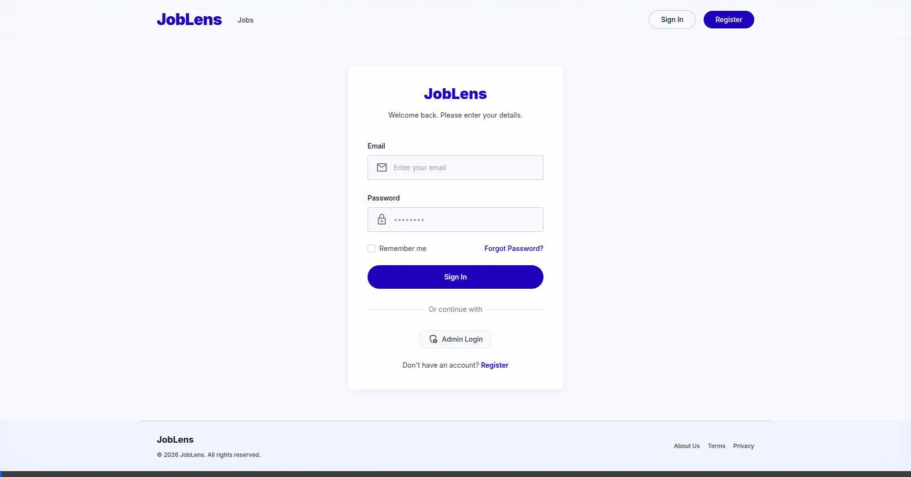
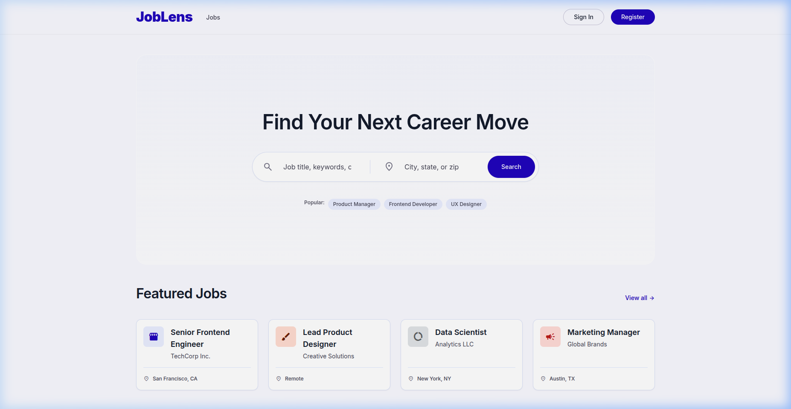
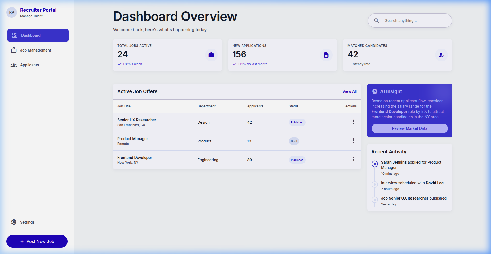
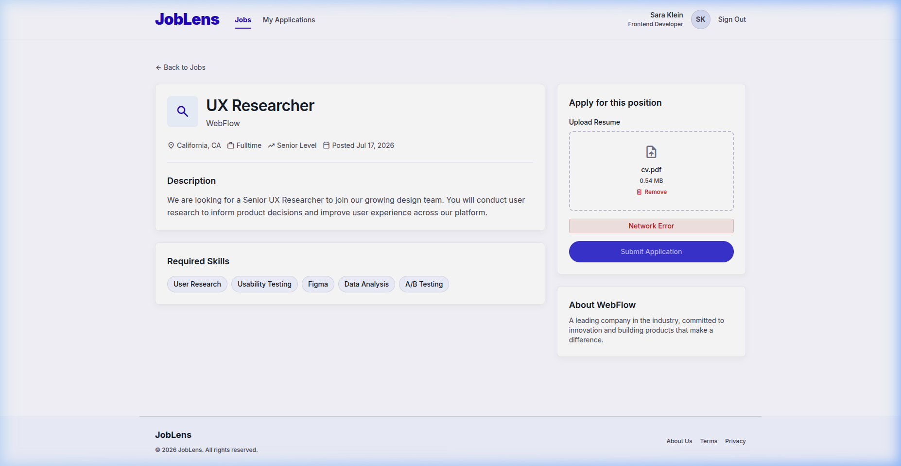
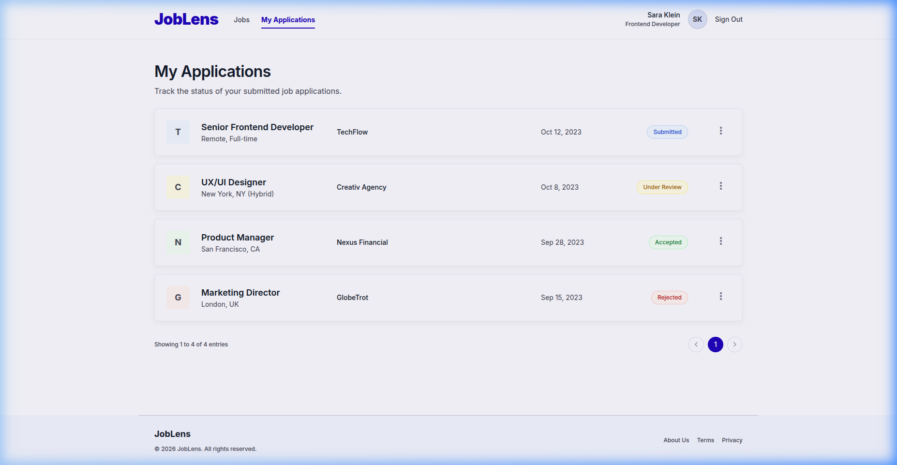

## License
   © 2026 Elhabchi Mohammed. All Rights Reserved.

# JobLens

A modern job board platform built with **React + Vite** for the frontend and **Flask** for the backend. Candidates can browse listings, view job details, and **upload their resume** to apply directly from the UI.

---

## Features
- Job listings with company details
- Detailed job page with an interactive **resume upload** component (drag‑and‑drop, file picker)
- Candidate authentication (login / signup)
- Manager dashboard for posting and managing jobs
- API powered by Flask with Supabase storage for uploaded resumes

---
## OpenAI API

The project uses the OpenAI API to compute a match score between a job posting and a candidate's uploaded CV, helping managers assess suitability.

You need an OpenAI API key set in the environment:

```
OPENAI_API_KEY=your-key-here
```

Add this to `backend/.env` (or `.env.example`). The backend handles the API calls; the frontend does not need direct access.


## Demo
Below is a short video showing the end‑to‑end flow:



---

## Screenshots
| Landing page | Manager dashboard |
|---|---|
|  |  |

**Application submission error (CORS)**



**Applications list after successful submit**



---

## Setup
### Prerequisites
- **Node.js** (>=18) and **npm**
- **Python 3.11** and **virtualenv**
- **Supabase** account (for file storage) – credentials go in `backend/.env`

### Backend
```bash
cd backend
python -m venv venv
source venv/bin/activate
pip install -r requirements.txt
# copy example env and fill in your keys
cp .env.example .env
flask db upgrade   # run migrations
flask run          # runs on http://localhost:5000
```

### Frontend
```bash
cd ..   # project root
npm install
npm run dev   # runs on http://localhost:5173
```

The frontend reads the API URL from `.env` (or `.env.example`):
```
VITE_API_URL=http://localhost:5000/api
```

---

## Running the full stack
1. Start the Flask server (`npm run dev` in the root for the Vite dev server).
2. Open `http://localhost:5173` in a browser.
3. Register a candidate account, browse jobs, and **upload a PDF/DOC/DOCX** resume on the job detail page.
4. After submission you should see a success toast and the application appear under **My Applications**.

---

## Testing
- Backend tests: `pytest`
- Frontend: manual UI testing (see the demo video above).

---

## Contributing
1. Fork the repo
2. Create a feature branch (`git checkout -b feat/awesome-feature`)
3. Open a pull request with a clear description and screenshots if UI changes.

---

## License
MIT © 2026 Yassin
